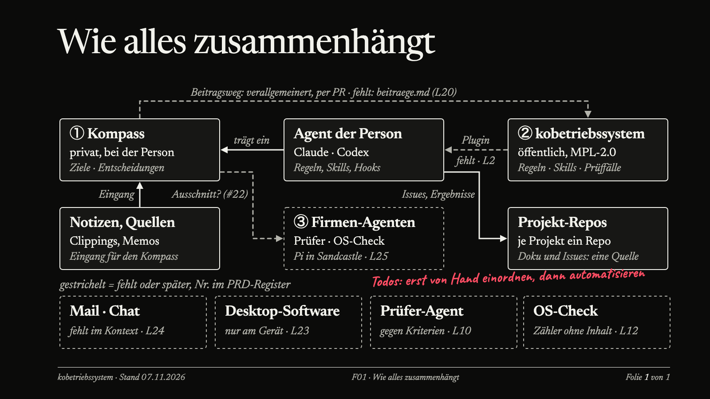
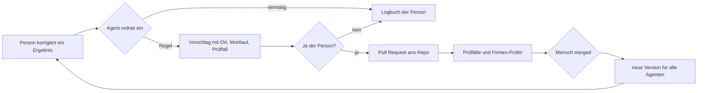

# kobetriebssystem – Vorlage

> **In Arbeit.** Wir testen gerade viel und wählen erst danach aus. Ziel ist ein Betriebssystem, das sich in vorhandene
> Werkzeuge einfügt, statt ein neues Produkt vorauszusetzen. Mitarbeitende arbeiten mit verbreiteten Agenten wie Claude oder
> Codex; die Firma betreibt daneben eigene Agenten, etwa einen Prüfer, mit einem schlanken, genau eingestellten Harness. Für
> diese Firmen-Agenten testen wir Harnesses von Pi bis DeepSeek Harness. Nächster Schritt ist ein MVP
> ([#25](https://github.com/enving/kobetriebssystem/issues/25)). Was noch offen ist, steht im Lückenregister der [PRD](PRD.md).

Blanke Vorlage für ein KI-Betriebssystem im Unternehmen. Ein Agent erledigt Aufgaben; vier Bausteine sagen ihm *wie* (Skills), *was* (Kontext), *womit* (Tools) und *was erlaubt ist* (Regeln); zwei Schleifen halten alles in Bewegung (Automatisierungen starten ohne Bitte, die Lernschleife macht das System mit jeder Korrektur besser). Alles Steuernde liegt als Textdatei in Git, jede Änderung ist ein Pull Request.

Diese Datei ist die **Navigation** – für Agenten und Menschen. Enthält keine Firmendaten. Die Vorlagen bleiben leer; ausschließlich erfundene Beispiele liegen getrennt in [beispiel/](beispiel/README.md). Das Standardpaket enthält keine Beispiel-Skills.

*Wie die Teile zusammenhängen, Stand 07.11.2026. Durchgezogen: vorhanden. Gestrichelt: fehlt oder kommt später, mit der Nummer
der Lücke in der [PRD](PRD.md).*

## Die Lernschleife: wie das System mit jeder Korrektur besser wird

Das ist der wichtigste Baustein. Der Agent selbst lernt nichts dazu; besser werden die Dateien, die alle Agenten lesen:
Skills, Regeln, Kontext und Prüffälle. Eine Korrektur, die nur in einem Chat passiert, ist in der nächsten Sitzung wieder
weg. Erst wenn sie geprüft ins Repo zurückfließt, profitieren alle.

1. **Einordnen.** Nach jeder Korrektur fragt der Agent: einmalig oder eine Regel, die wieder nötig wäre? Im Zweifel
   einmalig ([AGENTS.md](AGENTS.md), Regel 6).
2. **Vorschlagen.** Bei einer Regel nennt er Ort, Wortlaut und einen neuen Prüffall. Rohchats und Personendaten gehen nicht mit.
3. **Ja und Pull Request.** Nichts ändert sich still. Ampel, Sperren und Grundregeln ändert nur ein Mensch.
4. **Prüfen.** Die Prüffälle laufen, ein Firmen-Agent prüft den Vorschlag, ein Mensch merged.
5. **Verteilen.** Die neue Version kommt in jede Arbeitsumgebung, als Plugin oder Profil.
6. **Über Personen hinweg.** Ein wöchentlicher OS-Check zählt wiederkehrende Muster, ohne Inhalte zu sammeln, und schlägt
   ab drei gleichen Fällen eine Verbesserung vor. Was viele oft nutzen, was alle Prüffälle besteht und kaum noch korrigiert
   wird, kann zur Routine werden.

Damit die Schleife durchläuft, fehlt noch einiges: der Rückweg ohne Leserecht aufs Repo
([#28](https://github.com/enving/kobetriebssystem/issues/28)), die Zähler für den OS-Check und der Rückfluss aus dem
persönlichen Kompass (PRD L12, L20, L21). Den ersten Durchlauf zeigt das MVP.

## Agenten und Werkzeuge: was wir gerade testen

| Wer | Womit | Stand |
|---|---|---|
| Mitarbeitende | verbreitete Agenten: Claude, Codex | MVP auf einem Windows-Testgerät ohne Adminrechte; Microsoft Copilot später |
| Firmen-Agenten: Prüfer, OS-Check, Routinen | schlanker Harness mit genau eingestellten Rechten, abgeschottet | Pi in Sandcastle für den Prüfer im MVP; Vergleich mit pi-durable und DeepSeek Harness ([Recherche](docs/architektur/harness-firmenagenten-2026-11-07.md)) |
| Persönliche Assistenz | Hermes Agent | zweiter Adapter im MVP |
| Laufzeit für Teams | Rakazo, Microsoft, Paperclip | zurückgestellt |

Alles kommt aus einem Repo: Der Bauschritt erzeugt je Arbeitsumgebung ein Paket, etwa ein Plugin für Claude oder ein
Profil für Hermes. Eine Auswahl treffen wir erst, wenn ein Test zeigt, dass ein Werkzeug eine Lücke schließt. Die laufende
Produktsicht steht in der [PRD](PRD.md), §8.

## Für Agenten: Lesereihenfolge
1. **Beim Start nur:** `AGENTS.md` → `kontext/index.md` → `kontext/landkarte.md` → `persoenlich/<ich>/anweisungen.md`.
2. **Danach bei Bedarf:** passenden Skill wählen (Beschreibung im Kopf der `SKILL.md`), dessen `nutzt_kontext`-Dateien lesen, Landkarte für Systeme außerhalb des Repos.
3. **Nie** alles lesen. Je weniger am Anfang geladen wird, desto besser bleibt der Agent bei der Aufgabe.

## Wie eine Aufgabe läuft
Auslöser (Bitte im Chat, Zeitplan oder Ereignis) → Agent erkennt die Aufgabe → zieht Skill, Kontext, Regeln, Tools → Prüf-Agent prüft gegen die Kriterien des Skills → Ergebnis liegt als **Entwurf** bereit oder der Agent stellt die eine Frage, die er nicht selbst entscheiden darf → Mensch prüft, ändert, sendet selbst → jede Änderung des Menschen startet die Lernschleife.

## Wegweiser: wozu was dient

### Steuerung (Wurzel)
| Datei | Zweck | Wer ändert |
|---|---|---|
| `AGENTS.md` | Grundregeln für jeden Agenten: Verhalten, Ampel, Lernschleife | nur Mensch, per PR |
| `CLAUDE.md` | Wegweiser für das primäre Modell; verweist auf `AGENTS.md` (andere Modelle: gleiche Datei unter eigenem Namen) | Mensch |
| `SICHERHEIT.md` | Technische Sperren, Datenschutz, Checkliste vor dem Rollout | Mensch |
| `PRD.md` | Umfang, MVP und Lückenregister der Vorlage selbst | Agenten schlagen vor, Tristan entscheidet |
| `Übergabe.md` | Stand, offene Fragen, nächste Schritte der Vorlage selbst (nur lokal) | wer an der Vorlage arbeitet |
| `index.md` | Tabellen-Überblick über alle Ordner | bei Strukturänderung |

### Skills – *wie wir arbeiten* (`.agents/skills/`)
Ein Ordner je wiederkehrender Aufgabe: `SKILL.md` (Auslöser, Ergebnis, „Fertig heißt …“, Stolperfallen) und `evals/` (Prüffälle: Normalfall, fehlende Info, Grenzfall; Ergebnisse je Testlauf). Ein Skill beschreibt Ziel und Kriterien, nicht Schritte, und verweist auf Kontextdateien statt Preise oder Regeln zu kopieren. Neuer Skill: `_vorlage/` kopieren. Erst wenn alle Prüffälle bestanden sind, darf er als Automatisierung laufen. Jede Korrektur wird ein neuer Prüffall.

### Kontext – *was wir wissen* (`kontext/`)
Wiki für Dauerhaftes (Angebot, Prozesse, Stimme). Ein Ordner je Arbeitsgebiet mit einem Besitzer. Regeln je Datei: eine Aussage = eine Quelle, ein Prüfdatum, nur was *jetzt* gilt. Der Agent pflegt ein, Menschen sagen ihm, was gilt.
- `index.md` – Verzeichnis (eine Zeile je Bereich/Datei), zuerst lesen.
- `landkarte.md` – *wo Daten außerhalb des Repos liegen* und was der Agent dort nie tun darf. Laufende Arbeit (Mails, Kunden, Projekte) bleibt in den Tools und wird live mit den Rechten der Person gelesen.
- `glossar/` – kontrolliertes Vokabular: neue Begriffe per PR, von Agenten und Menschen geschärft.
- `_vorlage-bereich/_vorlage.md` – Dateivorlage; `log.md` – Änderungslog.

### Automatisierungen – *ohne uns* (`automatisierungen/`)
Ein Auftrag je Routine als Textdatei: Auslöser, Skill, erlaubte Quellen, Ergebnisort, „Nie“. `takt.md` ist der Taktplan. Eingeschaltet wird erst nach sauberen Testläufen und Freigabe des Verantwortlichen. Vorher den Prozess oft genug selbst mit KI durchlaufen, sonst entsteht automatisiert Ausschuss. Rückfragen kommen per Chat an die Person.

### Regeln – *was erlaubt ist*
`AGENTS.md` (Ampel, Security by Instruction) und `system/` (Security by Design). Rot gilt immer, gelb nach Rückfrage, grün selbst.

### Tools – *womit*
Keine Ordner im Repo. Tools hängen über Konnektoren an der Person; Rechte werden nur im Tool vergeben. Was der Agent dort darf/nie darf: `kontext/landkarte.md`. Alles Nach-außen-Gehende bereitet der Agent nur vor.

### Persönliche Ebene (`persoenlich/`) und Prompts (`prompts/`)
- `persoenlich/_vorlage/` – Anweisungen (Rolle, Ziele, Stil) und Logbuch einer Person. Gehört der Person; fließt nur per PR ins zentrale Wissen zurück.
- `prompts/` – gemeinsame Prompt-Bibliothek, rollenbasiert verteilt.

### Plattform (`installation/`, `plugins/`, `system/`)
- `installation/` – wie dieses Betriebssystem selbst als Plugin gebaut, per GitHub Actions geprüft und an alle Geräte verteilt und aktualisiert wird (Rollen, Managed Settings).
- `plugins/` – externe, zusätzliche Plugins für die Agenten-App (Konnektoren u. Ä.), die das Betriebssystem ergänzen.
- `system/` – Prüfprogramme und Sperren: `sperren.txt` (Pfad-Sperrliste), `hooks/` (Senden stoppen, Pfade/klassifizierte Dateien sperren, Beispielkonfiguration).

### Doku (`docs/`)
`anmerkungen.md` (Anmerkungen → Umsetzung), `recherche.md`, `szenarien.md` (lokal vs. zentral), `pruefszenarien.md` (Prüfszenarien je Harness), `beobachtungen.md`.
Anleitung: [Hooks erstellen und verlässlich prüfen](docs/hooks-erstellen.md).

## Wer darf was
| | lesen | ändern |
|---|---|---|
| Agent | im Rahmen der Person | nur per PR-Vorschlag; Kontext nach Anweisung der Besitzer |
| Besitzer eines Bereichs | ja | entscheidet, was gilt |
| Ampel, Sperren, Grundregeln | alle | nur ein Mensch |

## Status
Entwurf. Umfang, MVP und offene Architekturlücken: [PRD.md](PRD.md). Aufgaben und Fragen: GitHub-Issues.

## Warum es dieses Repo gibt: Betrieb, Haftung, EU AI Act

### Laufzeit ist nicht Betrieb

Agenten-Plattformen liefern, was Agenten im Team brauchen: einen Chat, eine eigene Sandbox je Agent, gemeinsame Nutzung. Welche Komponente dafür geeignet ist, wird noch recherchiert; das Repo ist bewusst nicht an eine bestimmte gebunden. Solche Plattformen liefern in der Regel nicht, was ein Unternehmen zusätzlich braucht: wer welchen Agenten mit welchen Tools und Daten einsetzen darf, wer das freigibt, was nachweisbar protokolliert wird und was passiert, wenn etwas schiefgeht. Die Haftungsfrage bleibt beim Unternehmen. Dieses Repo ist die Schicht dafür: ein **Betriebssystem im Sinn von Betriebsführung**, das über der Laufzeit liegt. Es ist ein Vorlagen-Satz für Unternehmen in Europa, damit sie nicht leer starten: Grundregeln, Rechte, Beschreibungen der Skills, Sicherheitsleitplanken, Freigabetore.

### Wer selbst baut, wird nach dem EU AI Act schnell zum Anbieter

Der AI Act unterscheidet **Betreiber** (setzt ein fertiges KI-System ein) und **Anbieter** (entwickelt ein System oder lässt es entwickeln und nimmt es unter eigenem Namen in Betrieb). Wer Agenten für das eigene Unternehmen selbst zusammenstellt, mit eigenen Skills, Tools und Regeln, sitzt deshalb leicht auf der Anbieterseite, auch wenn das Modell von außen kommt (Art. 3 Nr. 3 und 4, Art. 25). Eine Zweckänderung kann ein harmloses System zu einem Hochrisiko-System machen, etwa wenn ein Agent Bewerbungen vorsortiert oder Personalentscheidungen vorbereitet (Anhang III).

Für Hochrisiko-Systeme gelten dann Anbieterpflichten: Risikomanagement (Art. 9), Daten-Governance (Art. 10), technische Dokumentation (Art. 11), automatische Protokollierung (Art. 12), Transparenz (Art. 13), menschliche Aufsicht (Art. 14), Genauigkeit, Robustheit und Cybersicherheit (Art. 15), ein Qualitätsmanagementsystem (Art. 17) und Beobachtung nach dem Einsatz (Art. 72). Das sind keine Dokumente, die man einmal schreibt, sondern Tätigkeiten, die dauernd laufen müssen. Dafür braucht ein Unternehmen **operatives Management**, und genau das soll dieses Repo als Vorlage geben, neben der Laufzeit.

### Was das Repo davon abdeckt

Die Zuordnung ist ein Ansatz, **kein Konformitätsnachweis**. Ob ein konkretes System Hochrisiko ist und was dann genügt, prüft die Rechts- und Compliance-Stelle des Unternehmens.

| Anforderung | Was dieses Repo dazu beiträgt | Lücke |
|---|---|---|
| Risikomanagement (Art. 9) | Ampel in `AGENTS.md`, Prüffälle je Skill, Sperren in `system/` | [OFFEN: Risikoregister je Einsatzzweck] |
| Daten-Governance (Art. 10) | `kontext/` mit Besitzer und Prüfdatum, `kontext/landkarte.md` (was der Agent wo nie tun darf) | [OFFEN: Datenklassen und Löschfristen] |
| Technische Dokumentation (Art. 11) | `SKILL.md` je Aufgabe, Kontext, `docs/`, alles versioniert | [OFFEN: Abbildung auf Anhang IV] |
| Protokollierung (Art. 12) | Git-Verlauf und Pull Requests für alles Steuernde | [OFFEN: Laufprotokolle der Agenten in der Laufzeit] |
| Menschliche Aufsicht (Art. 14) | Entwurf statt Senden, Rot nie, Gelb nach Rückfrage, Ampel ändert nur ein Mensch | [OFFEN: benannte Aufsichtsperson je Agent] |
| Qualitätsmanagement (Art. 17) | Lernschleife, Pull-Request-Pflicht, Evals vor jeder Automatisierung | [OFFEN: Abgleich mit ISO/IEC 42001] |
| Beobachtung nach dem Einsatz (Art. 72) | Lernschleife, `docs/beobachtungen.md` | [OFFEN: Meldeweg bei Vorfällen] |

Als Managementsystem-Rahmen dient ISO/IEC 42001; für Identität und Governance-Werkzeuge ist Microsoft vorgesehen (Arbeitsentscheidung, siehe Architekturbericht).

### Stand der Fristen

Die Hochrisiko-Pflichten für Anhang-III-Systeme sollten ab 2. August 2026 gelten. Der „Digital Omnibus" verschiebt sie nach übereinstimmenden Berichten auf den **2. Dezember 2027** (Produkte nach Anhang I: 2. August 2028). Die Quellen nennen unterschiedliche Daten für das Inkrafttreten (27. oder 31. Juli 2026); [OFFEN: Wortlaut gegen EUR-Lex prüfen, bevor die Zahlen in Außentexte gehen]. Das Gesetz gilt also noch nicht in voller Härte, aber die Vorbereitung ist der längere Teil: Einsatzzwecke erfassen, Rollen klären, Nachweise von Anfang an erzeugen. Quellen: [Gibson Dunn](https://www.gibsondunn.com/eu-ai-act-omnibus-agreement-postponed-high-risk-deadlines-and-other-key-changes/), [euaiact.com](https://www.euaiact.com/digital-omnibus-ai), [Mondaq](https://www.mondaq.com/eu-digital-omnibus-on-ai-enters-into-force/1825722), Stand 05.11.2026.

## Wer KI nur Texte schreiben lässt, verpasst das Eigentliche

### Das eigentliche Thema heißt Steuerung, nicht Prompten

Die meisten Beiträge über künstliche Intelligenz drehen sich um Werkzeuge: welche App, welches Modell, welcher Trick für bessere Ergebnisse. Das ist jedoch nur die Oberfläche. Wer KI dauerhaft in seinen Arbeitsalltag einbaut, stellt bald fest, dass sich nicht das Werkzeug verändert, sondern die eigene Position innerhalb der Arbeit.

Nach und nach wandert die Ausführung ab. Recherchieren, formulieren, gestalten, übertragen — das übernimmt zunehmend das System. Was bleibt, ist eine Aufgabe, die vorher kaum jemand ausdrücklich hatte: den Überblick zu behalten.

### Vom Handwerker zum Dirigenten

Ein Vergleich aus der Musik beschreibt das gut. Ein Dirigent spielt kein einziges Instrument. Dennoch entscheidet allein sein Einsatz darüber, ob ein Ensemble zusammenklingt oder jeder Musiker für sich spielt. Die Leistung liegt nicht im eigenen Ton, sondern im Tempo, in der Balance und darin, das Richtige zur richtigen Zeit zu verlangen.

Mit KI verschiebt sich die eigene Rolle in genau diese Richtung. Nicht mehr jede Motion selbst auszuführen, sondern Abläufe zu gliedern, Teilaufgaben zu vergeben, Qualitätsmaßstäbe festzulegen und am Ende zu bewerten, ob das Ergebnis den Ansprüchen genügt — das wird zur Kernkompetenz.

### Ein Beispiel aus dem Alltag: die Kundenpräsentation

Nehmen wir eine Aufgabe, die in vielen Berufen regelmäßig vorkommt: die Vorbereitung einer Präsentation für ein Kundengespräch. Auf den ersten Blick ist das eine einzige Tätigkeit. Bei näherem Hinsehen zerfällt sie in eine Kette ganz unterschiedlicher Schritte:

1. Ziel klären: Was soll das Gegenüber am Ende wissen, wofür entscheiden?
2. Material sammeln: Zahlen, Beispiele, Argumente, Einwände.
3. Dramaturgie festlegen: Reihenfolge, Kernerzählung, roter Faden.
4. Folien bauen: Text, Grafiken, Layout.
5. Qualitätskontrolle: fachlich korrekt? verständlich? auf Zielgruppe zugeschnitten?
6. Übergabe und Nachbereitung: Termin, Feedback, Anpassungen für die nächste Runde.

Wer diese Stationen nie benennt, dessen KI-Einsatz bleibt Zufall. Wer sie dagegen einmal aufgeschrieben hat, kann sie prüfen, sortieren und Schritt für Schritt aus der Hand geben — angefangen bei den Schritten, die am wenigsten Nachdenken verlangen.

### Fachwissen verliert keinen Wert — es wechselt den Einsatzort

Eine verbreitete Sorge lautet: Wenn die Maschine schreibt, wird das eigene Können überflüssig. Das Gegenteil trifft zu. Das Wissen wird knapper und wertvoller, aber es wird an einer anderen Stelle gebraucht — nicht mehr bei der Erzeugung, sondern bei der Bewertung und beim Aufbau des Systems.

Wer gut ist, weiß Antworten auf Fragen dieser Art:

- Wonach beurteilt man, ob eine Recherche vollständig ist?
- Woraus ergibt sich, dass eine Argumentation trägt?
- Welche Fehler entlarven einen Text als austauschbar?
- Wo verläuft die Grenze zwischen kreativem Spielraum und fachlicher Genauigkeit?

Ein System kann nur so gut arbeiten, wie die Person, die es einrichtet, diese Fragen beantworten kann. Automatisierung setzt Urteilsvermögen voraus, sie ersetzt es nicht.

### Erst kartieren, dann automatisieren

Bevor irgendetwas an eine KI übergeben wird, lohnt ein Schritt, der völlig ohne Technik auskommt: die Aufgabe einmal in Ruhe beschreiben. Fünf Fragen genügen:

- Was liegt vor, wenn die Aufgabe beginnt — und wie sieht das fertige Ergebnis konkret aus?
- Durch welche Stationen läuft die Arbeit dazwischen?
- An welchen Punkten wird entschieden, und wer entscheidet?
- Welche Stationen sind reine Routine, welche verlangen Erfahrung?
- Wohin fließt das Ergebnis, und was passiert danach damit?

Das kostet zunächst Zeit und liefert keine sichtbaren Resultate. Es verhindert aber den häufigsten Fehler beim Arbeiten mit KI: viele begonnene, halb fertige und nicht abgestimmte Versuche, deren Verwaltung am Ende mehr Aufwand verursacht als die ursprüngliche Aufgabe selbst.

### Der erste Schritt ist klein

Für den Einstieg genügt eine einzige Übung: eine wiederkehrende Aufgabe auswählen — und nur ihre Stationen auflisten. Nichts automatisieren, nichts optimieren. Wer die Liste einmal vor sich hat, sieht meist sofort, wo sich ein erster, risikofreier Einsatz lohnt: dort, wo die Arbeit gleichförmig ist und das Urteilsvermögen nicht beansprucht wird.

Der Gewinn entsteht selten am ersten Tag. Er entsteht, wenn aus einzelnen Werkstücken allmählich ein System wird, das auch ohne ständige Anleitung läuft.

## Lizenz und Mitmachen
Mozilla Public License 2.0 (`LICENSE`). Verbesserungen, die nicht firmenspezifisch sind, bitte als Pull Request zurückgeben – Details in `CONTRIBUTING.md`.
