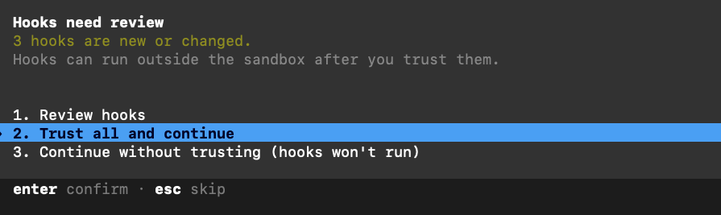

# Hooks erstellen und verlässlich prüfen

Stand: 03.11.2026. Anleitung für Entwickler und Agenten, die diese Vorlage erweitern.
Sie dokumentiert Erkenntnisse aus einem lokalen Referenzpflege-Hook. Sie installiert
keinen zusätzlichen Hook und ändert keine Sperre dieser Vorlage.

## Zuständige Dateien zuerst lesen

| Frage | Quelle in dieser Vorlage |
|---|---|
| Welche Grundregeln und Grenzen gelten? | [AGENTS.md](../AGENTS.md), [SICHERHEIT.md](../SICHERHEIT.md) |
| Welche Hooks und Adapter gibt es schon? | [system/](../system/README.md), insbesondere [hooks/](../system/hooks/) |
| Welche Schnittstelle wurde wie geprüft? | [Werkzeug-Matrix](../installation/werkzeuge.md) |
| Wie werden Hooks verteilt und aktualisiert? | [Installation](../installation/README.md) |
| Welche gemeinsamen Prüffälle existieren? | [Testbatterie](../system/tests/pruefen.mjs) und [Fälle](../system/tests/faelle.json) |

Ein neuer Hook ergänzt die vorhandenen Quellen. Er bekommt keine eigene Kopie der
Grundregeln, Sperrliste oder Gestaltungsvorgaben. Bei geänderten Hersteller-Schnittstellen
die Originaldokumentation prüfen; diesen Text nicht als eingefrorene API-Spezifikation behandeln.

## 1. Zweck und Ereignis festlegen

Vor dem Bauen benennen: Was soll der Hook beobachten? Soll er informieren oder einen
konkreten Aufruf ablehnen? Welche erlaubten Gegenfälle müssen weiter funktionieren?

Für Codex und Claude Code sind diese Ereignisse für den beschriebenen Anwendungsfall relevant:

| Ereignis | Geeigneter Einsatz |
|---|---|
| `SessionStart` | Aktuelle Quelle beim Sitzungsstart als Kontext bereitstellen |
| `UserPromptSubmit` | Eine kurze Regel bei einer neuen Benutzereingabe erneut verfügbar machen |
| `PreToolUse` | Einen bevorstehenden Werkzeugaufruf prüfen und gegebenenfalls ablehnen |
| `PostToolUse` | Das bereits erzeugte Ergebnis kontrollieren; der Schreibzugriff ist schon erfolgt |
| `Stop` | Abschließende Prüfung; wiederholte Auslösung und Endlosschleifen berücksichtigen |

Eine Erinnerung ist keine technische Sperre. Eine Prüfung nach dem Schreiben verhindert
den ursprünglichen Schreibzugriff nicht. Andere Agenten benötigen ihre jeweiligen Adapter;
die Namen und Datenformen dieser Ereignisse nicht ungeprüft übertragen.
Schnittstellen: [Codex Hooks](https://learn.chatgpt.com/docs/hooks),
[Claude Code Hooks](https://code.claude.com/docs/en/hooks).

## 2. Regel, Prüfung und Adapter trennen

Die fachliche Regel bleibt an ihrer zuständigen Quelle. Eine gemeinsame Prüffunktion
liest sie und liefert ein Ergebnis. Der Adapter übersetzt Eingabe und Ergebnis in das
Format des jeweiligen Agenten. So können mehrere Agenten dieselbe Prüfung nutzen.

Das vorhandene [SessionStart-Beispiel](../system/hooks/sessionstart-kontext.sh) liest
den Projektstand aus einer Datei. Die
[Pfadprüfung](../system/hooks/sperre-pfade.sh) liest die Sperrliste. Diese Dateien
beim Erweitern referenzieren; ihre Inhalte nicht in mehrere Hooks einkopieren.

Für einen Referenzpflege-Hook bedeutet das:

- Die zuständige Regelquelle lesen, statt ihren Wortlaut im Skript zu wiederholen.
- Vergleichswerte aus vorhandenen Quellen laden. Ein eigenes Register kopierter
  Designwerte würde genau die zusätzliche Pflege erzeugen, die verhindert werden soll.
- Nur relevante neue Inhalte prüfen. Eine bestehende fremde Änderung im Arbeitsbaum
  darf nicht als neue Änderung des gerade laufenden Agenten behandelt werden.
- Ausgabe-Artefakte, ausführbaren Code und bewusste Testbeispiele von dauerhaften
  Anweisungen unterscheiden. Feste Werte können für eine konkrete Ausgabe nötig sein.
- Bei einem Treffer Ziel und mögliche zuständige Quelle nennen, damit der Agent eine
  Referenz setzen oder die Quelle ändern kann.

**Einschätzung (GPT-6.1-sol, 03.11.2026):** Exakte längere Textkopien und Gruppen
übernommener Werte sind als lokale Heuristik brauchbar. Ob anders formulierte Regeln
inhaltlich dasselbe meinen, ist dadurch nicht zuverlässig entschieden. Ein pauschaler
Bann aller Konstanten würde legitime Arbeit behindern.

## 3. Datenvertrag prüfen

Ein Command-Hook bekommt JSON auf stdin. Dieses vereinfachte Beispiel beschreibt
einen `PreToolUse`-Aufruf; echte Ereignisse enthalten weitere Felder:

```json
{
  "hook_event_name": "PreToolUse",
  "cwd": "/projekt",
  "tool_name": "Bash",
  "tool_input": {"command": "echo probe"}
}
```

Nicht von einem einzigen Werkzeug auf alle schließen: Claude-Dateiwerkzeuge liefern
beispielsweise `file_path`, `content` oder `old_string`/`new_string`. Codex meldet
`apply_patch` mit dem Patch in `tool_input.command`. Ein Shell-Befehl enthält dagegen
ausführbaren Text. Derselbe Feldname macht daraus kein identisches Prüfproblem.
Siehe [Codex: Tool coverage und PreToolUse](https://learn.chatgpt.com/docs/hooks#pretooluse)
und [Claude Code: PreToolUse input](https://code.claude.com/docs/en/hooks#pretooluse-input).

Die folgenden beiden JSON-Blöcke sind getrennte Ausgabeformen. Ein Hinweis nutzt
`additionalContext`; eine Ablehnung von `PreToolUse` nutzt `permissionDecision`:

```json
{
  "hookSpecificOutput": {
    "hookEventName": "PreToolUse",
    "additionalContext": "Die zuständige Quelle vor der Änderung lesen."
  }
}
```

```json
{
  "hookSpecificOutput": {
    "hookEventName": "PreToolUse",
    "permissionDecision": "deny",
    "permissionDecisionReason": "Mögliche Regelkopie: Ziel und zuständige Quelle prüfen."
  }
}
```

Diese Texte zeigen den Datenvertrag, keine zweite verbindliche Regelquelle.
Für die hier behandelten `PreToolUse`-Command-Hooks unterstützt auch Exit 2 mit
Begründung auf stderr eine Ablehnung. Ausgabe und Exitverhalten anderer Ereignisse
separat nachschlagen. Bei Codex wird einfacher stdout-Text für `PreToolUse` nicht als
Kontext übernommen. JSON mit einem Encoder erzeugen; Diagnoseausgaben gehören auf stderr.
Quellen: [Codex](https://learn.chatgpt.com/docs/hooks#pretooluse),
[Claude Code](https://code.claude.com/docs/en/hooks#pretooluse-decision-control).

## 4. Registrieren, ohne vorhandene Hooks zu ersetzen

Konfigurationsbeispiele liegen unter
[codex-hooks.json](../system/hooks/codex-hooks.json) und
[settings-beispiel.json](../system/hooks/settings-beispiel.json).
Sie sind Entwürfe, keine Anweisung, eine bestehende Benutzerkonfiguration zu überschreiben.

Ein Installer sollte bestehendes JSON lesen, nur seine eigenen Einträge ergänzen
oder aktualisieren und eine geänderte Datei vorher sichern. Ein zweiter Lauf muss
ohne doppelte Registrierung und ohne weitere Änderung enden. Fremde Hook-Gruppen,
Matcher, Berechtigungen und sonstige Einstellungen erhalten.

Den Pfad zur Implementierung unabhängig vom aktuellen Arbeitsverzeichnis auflösen.
Ein Agent kann in einem Unterordner starten. Für Projekt-Hooks den Projektstamm,
für Plugins die dokumentierte Plugin-Wurzel verwenden; vorhandene Beispiele nicht
blind mit relativen Pfaden übernehmen. Interpreter und Argumente korrekt quoten.
Unter Windows Interpreter und Pfadform gesondert prüfen. Verteilung und Paketbau
gehören in den [bestehenden Installationsweg](../installation/README.md).

Bei Codex müssen nicht verwaltete neue oder geänderte Hooks erst über `/hooks`
beziehungsweise die Hook-Einstellungen der App geprüft und als vertrauenswürdig
bestätigt werden. Registriert bedeutet daher noch nicht ausgeführt. Vertrauen nicht
durch selbst geschriebene Hashes oder einen Trust-Bypass vortäuschen. Nach Änderungen
prüfen, ob eine neue Sitzung zum Laden erforderlich ist.
Quelle: [Codex: Review and trust hooks](https://learn.chatgpt.com/docs/hooks#review-and-trust-hooks).

### Beobachtung: Freigabedialog im Terminal



*Nutzeraufnahme vom 03.11.2026, unverändert übernommen. Belegstufe: sichtbarer CLI-Dialog.*

Die Auswahl steht auf „Trust all and continue“. Das Bild zeigt die anstehende
Freigabe, nicht deren Abschluss und auch keinen erfolgreich ausgeführten Hook.
Für eine eigene Prüfung zunächst „Review hooks“ wählen. „Continue without trusting“
setzt ohne die neuen Hooks fort. Der Dialog weist außerdem darauf hin, dass
vertrauenswürdige Hooks außerhalb der Sandbox laufen können; ihre Skripte und
Abhängigkeiten gehören deshalb zur kontrollierten Installation.

Im zugehörigen Nutzerbericht war die Freigabe in der Desktop-App nicht erreichbar,
im Terminal dagegen schon. Die genaue Desktop-Version und die Ursache wurden
nicht ermittelt. Das ist keine allgemeine Aussage, dass Desktop-Hooks unmöglich seien:
Die aktuelle Hersteller-Doku nennt für Plugin-Hooks auch „Review hooks“ bzw.
„Settings → Hooks“ in der App. CLI, native Codex-Desktop-App und fremde Frontends
getrennt prüfen. Quelle: [Codex: Plugin-bundled hooks](https://learn.chatgpt.com/docs/hooks#plugin-bundled-hooks).

## 5. In mehreren Stufen testen

Die Belegstufen stammen aus der [Werkzeug-Matrix](../installation/werkzeuge.md).
Die folgenden Prüfungen beantworten unterschiedliche Fragen:

| Prüfung | Was sie belegt |
|---|---|
| Syntax, JSON und auflösbare Pfade | Konfiguration und Programm lassen sich grundsätzlich laden |
| Prüffunktion mit Fixtures | Erlaubte, gesperrte und fehlerhafte Eingaben werden unterschieden |
| Tatsächlich registriertes Kommando direkt aufrufen | Interpreter, Pfade, stdin, stdout, stderr und Exitcode passen zusammen |
| Nativer Konfigurationscheck, sofern vorhanden | Das installierte Programm akzeptiert seine Konfiguration |
| Harmloser echter Agentenlauf | Ereignis feuert, Vertrauen liegt vor und das Modell bekommt die Rückmeldung |

Für die vorhandenen Adapter lässt sich die gemeinsame Testbatterie aus dem Repo-Stamm
ausführen:

```sh
node system/tests/pruefen.mjs
```

Ein einzelner direkter Probelauf des vorhandenen Shell-Hooks ist ebenfalls möglich:

```sh
printf '%s\n' '{"hook_event_name":"PreToolUse","tool_name":"Bash","tool_input":{"command":"echo probe"}}' \
  | sh system/hooks/block-extern.sh
```

Dieser Probelauf sendet nichts und installiert nichts. Er ist ein Skripttest,
kein Nachweis, dass ein Agent den Hook tatsächlich aufgerufen hat.

Für neue Prüfungen mindestens einen erlaubten Fall, einen abzulehnenden Fall und
einen Grenzfall verwenden. Bei Referenzpflege zusätzlich: Quellenänderung erlaubt,
Quellenverweis erlaubt, konkrete Ausgabe erlaubt, neue Regelkopie abgelehnt,
vorbestehende Kopie bei einer anderen Änderung nicht fälschlich neu gemeldet.
Quellwerte zwischen zwei Tests ändern: Nur dann wird sichtbar, ob die Prüfung die
Quelle erneut liest oder selbst mit veralteten Kopien arbeitet.

Installation zweimal ausführen; anschließend eine Aktualisierung der Quelle bzw.
des Pakets simulieren. Prüfen, ob die Ergänzung erhalten bleibt und ob lokal geänderte
Dateien beim nächsten Sync überschrieben würden. Für einen echten Modelllauf nur
synthetische Daten und harmlose Werkzeuge verwenden; kein Senden, Löschen oder Bezahlen
als Testaktion ausführen.

## 6. Managed Hooks für den Unternehmensrollout

**Laut Hersteller-Doku möglich; hier noch nicht auf einem verwalteten Gerät geprüft.**
Der persönliche Freigabedialog oben beschreibt nicht den verwalteten Rollout:
Admin-Hooks aus verwalteten Quellen gelten durch Richtlinie als vertrauenswürdig
und lassen sich nicht im persönlichen Hook-Dialog abschalten.
Quelle: [Codex: Review and trust hooks](https://learn.chatgpt.com/docs/hooks#review-and-trust-hooks).

Für unterstützte lokale Codex-Laufzeiten können Administratoren Hooks direkt in
`requirements.toml` vorgeben. Der folgende TOML-Ausschnitt ist eine Installationsskizze
für Unix, keine bereits eingerichtete Richtlinie. Installationspfade und Prüfprogramm
müssen zum freigegebenen Paket passen:

```toml
# Nur verwaltete Hook-Quellen zulassen.
allow_managed_hooks_only = true

[features]
hooks = true

[hooks]
managed_dir = "/opt/kobetriebssystem/hooks"

[[hooks.PreToolUse]]
matcher = "*"

[[hooks.PreToolUse.hooks]]
type = "command"
command = "/bin/sh /opt/kobetriebssystem/hooks/sperre-pfade.sh"
timeout = 5
```

`requirements.toml` ist eine Admin-Vorgabe; dieselben Schlüssel in einer gewöhnlichen
Benutzerkonfiguration ersetzen diese Wirkung nicht. Die festgeschriebene Hook-Funktion
verhindert ein lokales Abschalten. Der optionale Modus für ausschließlich verwaltete
Hooks überspringt auch Plugin-Hooks: Ein separat installiertes KoBetriebssystem-Plugin
würde seine Hooks in diesem Modus nicht zusätzlich aktivieren.
Quelle: [Codex: Managed hooks](https://learn.chatgpt.com/docs/hooks#managed-hooks-from-requirements-toml).

### Verteilung und zuständige Ebene

Die Richtlinie verteilt keine Skripte. MDM bzw. Endpoint-Management muss das geprüfte
Paket samt Interpreter/Abhängigkeiten installieren und aktualisieren. Für das gezeigte
Prüfprogramm auch die von ihm gelesene Sperrliste gemäß seiner vorhandenen Pfadauflösung
mitliefern; Inhalt und Regeln bleiben in ihren bestehenden Quelldateien.
Schreibrechte auf Paket und Richtlinie gehören zur Admin-Ebene. Eine vom normalen
Benutzer änderbare Datei wäre keine verlässliche Durchsetzung.

Dokumentierte lokale Richtlinienwege sind unter anderem die Systemdatei
`/etc/codex/requirements.toml` auf Unix bzw.
`%ProgramData%\OpenAI\Codex\requirements.toml` unter Windows sowie verwaltete
macOS-Präferenzen. Unterstützte Organisationskonten können Anforderungen auch über
Agent Security erhalten. Aktuelle Pfade, Plattformschlüssel und Prioritäten ausschließlich
aus der [Managed-Configuration-Doku](https://learn.chatgpt.com/docs/enterprise/managed-configuration#locations-and-precedence)
und der [Konfigurationsreferenz](https://learn.chatgpt.com/docs/config-file/config-reference)
übernehmen. Keine lokalen Benutzer-Trust-Hashes als Rollout-Artefakt verteilen.

Lokale Codex-Hooks und Hooks bei Cloud-Orchestrierung sind verschiedene Ausführungspfade.
Für Work Cloud mit lokalem Zugriff dokumentiert OpenAI unter den jeweiligen
Organisationsvoraussetzungen verwaltete Remote-MCP-Hooks am Orchestrator; lokale
Shell-/Plugin-Hooks sind dort kein gleichwertiger Ersatz. Ein lokal ausgeführtes
Werkzeug beweist nicht, dass der gesamte Agent lokal orchestriert wird.
Quelle: [Managed configuration: Enforce managed hooks](https://learn.chatgpt.com/docs/enterprise/managed-configuration#enforce-managed-hooks-from-requirements).

### Folgerung für KoBetriebssystem

**Empfehlung (GPT-6.1-sol, 03.11.2026):** Den bestehenden
[Release-Weg](../installation/README.md) um einen Codex-Adapter für verwaltete
Richtlinie und Gerätepaket ergänzen. Das heutige Build-Skript erzeugt ein
Claude-Code-Plugin, noch keinen Codex-Managed-Rollout. Die fachlichen Prüfungen
bleiben gemeinsam; der Bauschritt erzeugt die plattformspezifische Verdrahtung.
Diese Anleitung ändert weder aktive Richtlinien noch die Sperren des Repos.

Vor einer Freigabe auf einem verwalteten Testgerät nachweisen:

1. Paket und Richtlinie werden vom normalen Nutzer nicht geändert; passende Client-
   und Runtime-Versionen sowie lokaler oder Cloud-Ausführungspfad sind protokolliert.
2. Der verwaltete Hook läuft ohne persönlichen Trust-Dialog. Ein harmloser erlaubter
   Aufruf funktioniert, ein gezielt abzulehnender Prüffall wird vor der Aktion gestoppt.
3. Eine lokale Einstellung zum Abschalten von Hooks setzt die Admin-Vorgabe nicht außer Kraft.
4. Falls nur verwaltete Hooks erlaubt sind, laufen Benutzer-/Projekt-/Plugin-Hooks
   tatsächlich nicht zusätzlich. Keine notwendige Prüfung bleibt dadurch unbemerkt aus.
5. Update und Rücknahme erreichen die Geräte; fehlendes Skript, Timeout und ungültige
   Antwort werden mit ihrem tatsächlichen Verhalten erfasst. Admin-Vertrauen allein
   macht eine fehlerhafte oder umgehbare Prüfung nicht zu einer vollständigen Sperre.

## Grenzen und beobachteter Stand

Der lokale Referenzpflege-Versuch wurde am 03.11.2026 als Prüffunktion und über
registrierte Kommandos getestet. Das ist Belegstufe **Skript**, keine Live-Abnahme
durch das Modell. Seine Implementierung wird mit dieser Vorlage nicht ausgeliefert.
Die bestehenden Sicherheitsadapter behalten ihre in der Werkzeug-Matrix dokumentierten
Grenzen; diese Anleitung hebt keine davon auf.

Beliebige Shellskripte, Exec-Wrapper und unbekannte MCP-Werkzeuge sind nicht durch
einen einfachen Textvergleich vollständig analysierbar. Eine Erinnerung für diese
Werkzeuge nicht als technische Inhaltsprüfung ausgeben. Ebenso kann eine Regex
keine umfassende semantische Prüfung von Regelduplikaten leisten.

Vor Abschluss festhalten: Programmversion, Betriebssystem, getestetes Ereignis,
Belegstufe, erwartete und tatsächliche Entscheidung sowie verbleibende Lücken.
Ein Timeout, fehlendes Vertrauen oder ungültiges JSON ist ein nicht erfolgreicher
Prüflauf. Ob ein solcher Fehler weiterlaufen darf oder blockieren soll, hängt vom
Zweck des Hooks und den Vorgaben aus [SICHERHEIT.md](../SICHERHEIT.md) ab.

## Prüfung dieser Anleitung

03.11.2026, 15:01 CET · GPT-6.1-sol · macOS:

- Lokale Links aufgelöst, drei JSON-Blöcke geparst und beide Shell-Blöcke auf Syntax geprüft.
- Den dokumentierten direkten Probelauf ausgeführt: Exit 0 wie erwartet.
- `node system/tests/pruefen.mjs`: 32 erwartete Ergebnisse und 12 als bekannt markierte
  Lücken über vier Adapter; keine unerwarteten Abweichungen.
- Keine Sicherheitsregeln, Hook-Implementierungen oder aktiven Konfigurationen geändert.
  Kein zusätzlicher echter Agentenlauf; keine Veröffentlichung.

Ergänzung vom 03.11.2026: Nutzer-Screenshot zum CLI-Trust-Dialog eingebunden und
Managed-Rollout gegen die verlinkte Hersteller-Doku recherchiert. TOML syntaktisch
geprüft; kein MDM-Rollout, kein verwalteter Hook-Lauf und keine Desktop-Abnahme.
Die erste TOML-Prüfung scheiterte am fehlenden `tomllib` im System-Python 3.9;
mit dem vorhandenen Python 3.14 wurden TOML, JSON, Links und Anker erfolgreich geprüft.
